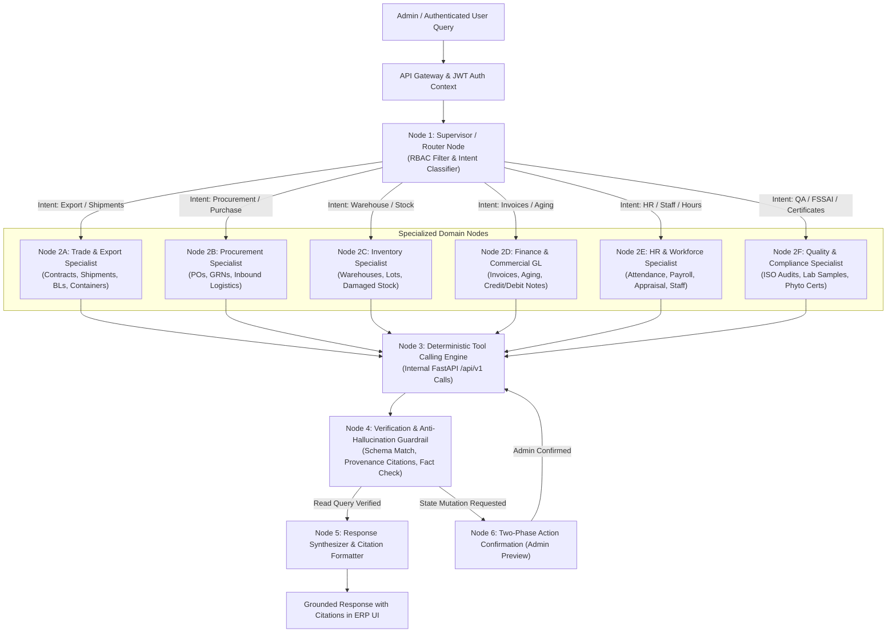

# SOILEX Executive AI Copilot: Multi-Node Architecture & Anti-Hallucination Blueprint

**System**: SOILEX Life Science — Enterprise ERP AI Copilot  
**Document Type**: Architectural Specification & Implementation Roadmap  
**Target Audience**: Engineering, Product & Executive Administration  
**Status**: Staging Blueprint (Ready for Phase 1 Integration)  

---

## 1. Executive Summary & Objective

The SOILEX Executive AI Copilot is designed to act as an autonomous, grounded enterprise assistant for the Executive Admin and department managers. It can answer business inquiries, summarize real-time operational status, query inventory, audit aging receivables, and propose/trigger ERP actions.

### Non-Negotiable Core Principles
1. **Zero Hallucination (Deterministic Grounding)**: The LLM never invents numbers, dates, contract numbers, or inventory quantities. Every statement is strictly grounded in live API data retrieved from DuckDB and FastAPI services.
2. **Multi-Node Graph Architecture**: The agent is split into specialized domain nodes coordinated by a Supervisor node (using a state machine / directed acyclic graph like LangGraph).
3. **Role-Based Access Control (RBAC)**: Capabilities, data visibility, and tool access are strictly gated based on the authenticated user's JWT role.
4. **Human-in-the-Loop (HITL) for State Mutations**: Read queries are instantaneous; state changes (e.g., approving POs, creating shipments, generating invoices) require explicit admin preview and confirmation.

---

## 2. Multi-Node Graph Architecture



---

## 3. Node Specifications & Responsibilities

### Node 1: Supervisor & Intent Router
- **Input**: User natural language prompt + `user_context` (User ID, Role, Department, JWT).
- **Function**:
  1. Validates that the user's role has permission to access the requested domain.
  2. Resolves ambiguous queries (e.g., "Show me Pepper status" -> asks whether the user means warehouse lot stock, active export contracts, or inbound procurement POs).
  3. Directs execution state to one or more specialist nodes.
- **Fail-Safe**: If an unauthorized role (e.g. `EMPLOYEE`) asks for financial ledger data or company-wide profit margins, immediately terminates with an RBAC denial before calling any specialist node.

### Node 2: Domain Specialists
Each specialist has dedicated prompt instructions, domain vocabulary (e.g. ASTA grade, CBM, MT, FOB/CIF, BL, GRN, LC at Sight), and a restricted set of OpenAPI tool bindings.

| Specialist Node | Domain Context & Jargon | Associated ERP API Endpoints |
|---|---|---|
| **Trade & Export** | Bill of Lading, Container seal, Port of Loading/Discharge, FOB/CIF, ASTA | `/api/v1/trade/contracts`, `/api/v1/trade/shipments`, `/api/v1/trade/containers` |
| **Procurement** | Purchase Orders, Inbound GRN, Supplier Lead Time, CAD, Advance Escrow | `/api/v1/procurement/purchase-orders`, `/api/v1/procurement/grns`, `/api/v1/procurement/summary` |
| **Inventory** | Bio-Hubs, Cryogenic lots, Batch numbers, Damaged stock, Reorder point | `/api/v1/inventory/stock`, `/api/v1/inventory/transactions`, `/api/v1/inventory/damages` |
| **Finance & GL** | Receivables aging, Overdue buckets (30/60/90+), Chart of Accounts, Debit notes | `/api/v1/finance/sales-orders`, `/api/v1/finance/invoices`, `/api/v1/finance/aging`, `/api/v1/finance/notes` |
| **HR & Workforce** | Timesheets, Statutory benefits, Leave allowances, Appraisals, OKRs | `/api/v1/employees`, `/api/v1/attendance`, `/api/v1/payroll`, `/api/v1/performance` |
| **Quality & QA** | FSSAI, ISO 22000, HACCP, Phytosanitary inspection, Moisture %, Piperine assay | `/api/v1/analytics/audit-logs`, `/api/v1/analytics/client-audits` |

### Node 3: Deterministic Tool Calling Engine
- Executes direct loopback HTTP calls to FastAPI endpoints using the user's bearer token.
- Returns structured JSON payloads.
- **No LLM code execution**: Tools are strictly pre-defined API functions with typed Pydantic parameters.

### Node 4: Anti-Hallucination & Provenance Guardrail
This node ensures complete factual truth:
1. **Provenance Linking**: Every entity or number mentioned in the draft response must exist in the raw JSON payload returned by Node 3.
2. **Entity Consistency**: Contract numbers (`SLX-EXP-2026-001`), Container IDs (`MSCU-884102-3`), and currency values (`$198,000 USD`) must match character-for-character.
3. **Absence Protocol**: If a tool returns `[]` or `404`, the synthesizer is forced to answer: *"No records match your criteria in the SOILEX database"* and is prohibited from suggesting plausible-sounding mock data.
4. **Temporal Grounding**: All date checks compare against the server's ISO timestamp (e.g., verifying whether an invoice is truly 60+ days past due).

### Node 5: Response Synthesizer & Citation Formatter
- Presents answers in clean, professional ERP markdown.
- Renders KPI pills, compact tables, and clickable entity links (`[CT-001]`, `[SH-901]`).
- Appends verification metadata:
  ```json
  {
    "verification_status": "GROUNDED_VERIFIED",
    "sources_queried": ["GET /api/v1/trade/shipments", "GET /api/v1/trade/containers"],
    "records_analyzed": 14,
    "confidence": 1.0
  }
  ```

### Node 6: Two-Phase Action Confirmation (Human-in-the-Loop)
For any action that modifies data (creating a PO, updating shipment customs status, approving a leave request):
1. **Phase 1 (Draft & Preview)**: The Copilot generates an Action Preview Card showing exact parameters (Supplier, Quantity, Incoterms, Total Value).
2. **Phase 2 (Confirmation)**: The Admin clicks `Execute Action` in the UI, which transmits an explicit confirmation token before the API `POST`/`PATCH` is executed.

---

## 4. Role-Based Access Control (RBAC) Matrix

| User Role | Read Access Scope | Write / Action Scope | Prohibited Access |
|---|---|---|---|
| **ADMIN** | Full ERP (all 12 modules, financial P&L, salaries, system logs) | Full Execution with HITL Confirmation | None |
| **HR_MANAGER** | Employees, Attendance, Payroll, Recruitment, OKRs, Staff Directory | Create/Approve Leaves, Onboarding, Timesheets | Financial GL, Export Shipments, Trade Margins |
| **QUALITY_MANAGER** | QC Labs, Warehouses, Phytosanitary, Damaged Stock, ISO Audits | Cleared/Reject Lots, Log Inspection | Payroll, Company Accounts, Sales Orders |
| **EMPLOYEE** | Personal Timesheet, Assigned Tasks, Calendar, Directory | Clock-In/Out, Request Leave, Update Tasks | All Financials, Procurement POs, Trade Contracts |

---

## 5. Business Context & Domain Glossary (Admin Editable)

> Fill in or expand these rules with company-specific policies before Phase 2 rollout so domain nodes interpret internal terminology accurately.

- **BOG Approval**: Board of Governance sign-off required for export contracts exceeding threshold value.
- **ASTA Grade**: American Spice Trade Association quality standard (e.g., Black Pepper 550 G/L ASTA).
- **Credit Hold Policy**: Any buyer with overdue balances in the `90+ Days` aging bucket is flagged for Credit Hold.
- **Safety Buffer / Reorder Point**: Minimum warehouse MT stock required before triggering Procurement PO draft.
- **Standard Incoterms**: FOB, CIF, CFR, EXW, DDP, FCA.

---

## 6. Implementation Roadmap

1. **Phase 1 (Complete)**: Multi-node architecture specification + interactive React UI placeholder (`src/components/copilot/AiCopilotDrawer.jsx`).
2. **Phase 2**: Expose `/api/v1/copilot/chat` in FastAPI and generate typed OpenAPI tool schemas from existing endpoints.
3. **Phase 3**: Implement LangGraph supervisor + 6 specialist nodes in `backend/app/copilot/` using `temperature=0.0` tool-calling.
4. **Phase 4**: Implement Node 4 Anti-Hallucination validator + JWT RBAC middleware enforcement.
5. **Phase 5**: End-to-end verification, HITL confirmation workflow, and audit telemetry logging.
